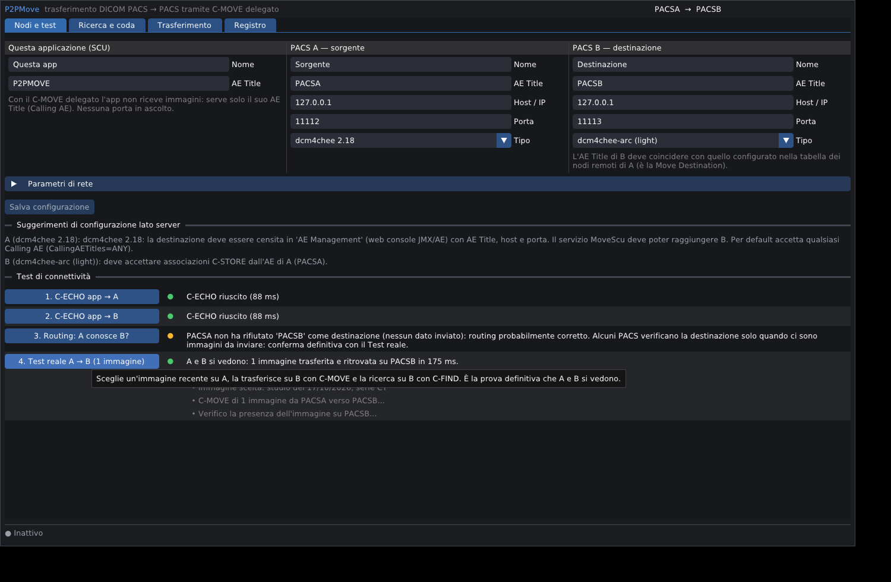
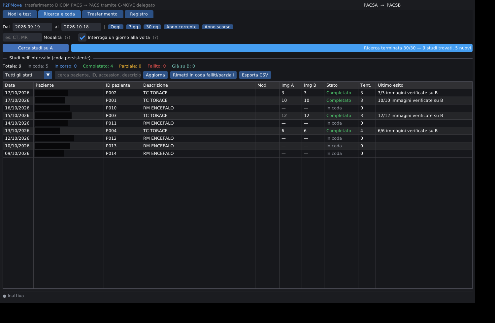
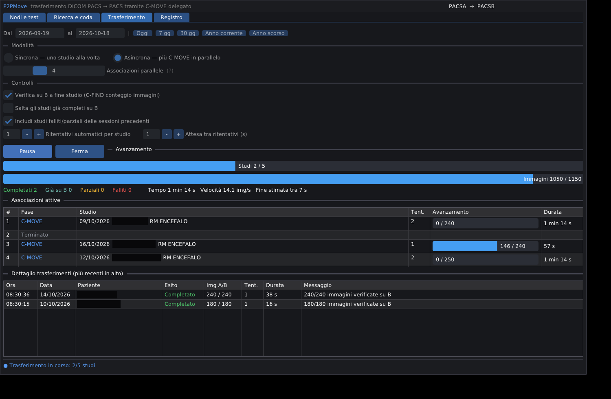
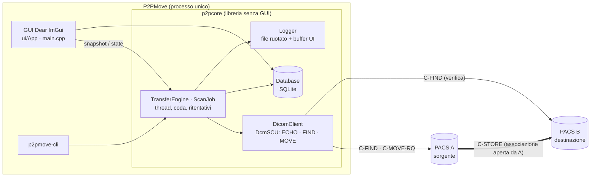
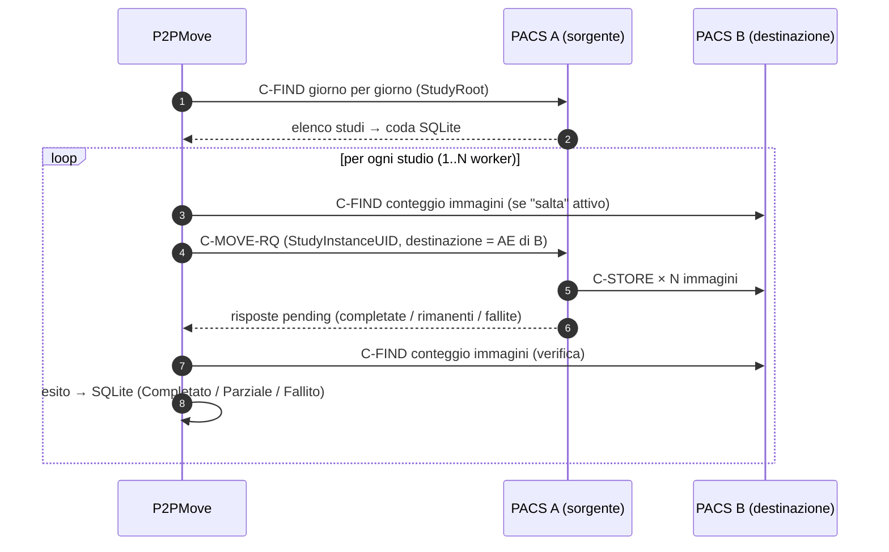
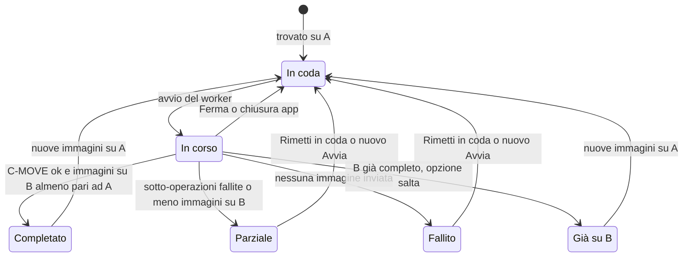

<div align="center">

# P2PMove

Trasferimento di esami DICOM da PACS a PACS tramite C-MOVE delegato.

P2PMove trasferisce al PACS destinazione gli studi del PACS sorgente senza che le immagini passino dal pc: l'app non le riceve e non le salva.


[Panoramica](#panoramica) ·
[Specifiche](#specifiche-tecniche) ·
[Architettura](#architettura) ·
[Compilazione](#compilazione) ·
[Uso](#uso) ·
[Configurazione PACS](#configurazione-lato-pacs) ·
[Risoluzione problemi](#risoluzione-dei-problemi) ·
[Struttura](#struttura-del-repository)

</div>

## Panoramica

P2PMove cerca gli studi sul PACS A in un intervallo di date, li mette in una coda persistente e
chiede ad A di inviarli al PACS B. A trasferimento finito controlla su B che le immagini siano
arrivate.

| Requisito | Dove si trova |
|---|---|
| Configurazione dei nodi A e B (e AE Title dell'app) | tab Nodi e test |
| Test di connettività: C-ECHO verso A e B, routing A→B, test reale con 1 immagine | tab Nodi e test |
| Scelta dell'intervallo di date (con scorciatoie 7/30 giorni, anno) | tab Ricerca e coda |
| Errori e mancati trasferimenti conservati per un nuovo tentativo | database SQLite, stati *Fallito* e *Parziale*, pulsante Rimetti in coda, esportazione CSV |
| Trasferimento sincrono o asincrono con avanzamento e ETA | tab Trasferimento (da 1 a 8 associazioni parallele) |
| Registro delle operazioni | tab Registro (file ruotato) |
| Stesso motore da terminale, per automazioni | `p2pmove-cli` |

> [!NOTE]
> Stato del progetto (1.1.2): compila e passa i test automatici. Il motore è stato collaudato su 
> PACS reali (dcm4chee v2.18, dcm4chee-arc, orthanc, horos).

### Schermate

<table>
<tr>
<td><br /><sub>Nodi e test</sub></td>
<td><br /><sub>Ricerca e coda</sub></td>
<td><br /><sub>Trasferimento asincrono</sub></td>
</tr>
</table>

## Specifiche tecniche

### Piattaforma e linguaggio

| Voce | Valore |
|---|---|
| Linguaggio | C++20 (`CMAKE_CXX_STANDARD 20`, estensioni del compilatore disattivate) |
| Compilatore | Apple Clang (Xcode Command Line Tools), provato con la versione 21.0.0 (`arm64-apple-darwin25`). Il `CMakeLists.txt` abilita `-Wall -Wextra` per Clang e GCC |
| Sistema di build | CMake 3.24 o successivo (provato con 4.4.4) e Ninja (provato con 1.13.2) |
| Piattaforma di destinazione | macOS 13 Ventura o successivo, Apple Silicon (arm64) |
| Sviluppo e collaudo | macOS 26 su Mac M3. Il motore è stato collaudato anche su Linux con `dcmqrscp` |
| Bundle | `P2PMove.app`, identificativo `local.p2pmove.app`, categoria *medical*, Retina, icona propria |
| Versione corrente | 1.1.2 (definita in `project(P2PMove VERSION …)` di `CMakeLists.txt`) |
| Dimensione del codice | circa 4.100 righe tra `src/` e `tests/` |

### Librerie

| Libreria | Versione | Uso | Come arriva nel progetto |
|---|---|---|---|
| DCMTK | 3.7.0 (Homebrew, sviluppo), 3.6.9 statico (release) | DICOM: associazioni, C-ECHO, C-FIND, C-MOVE, C-CANCEL, dizionario, set di caratteri. Classe base `DcmSCU` (modulo *dcmnet*) | `brew install dcmtk` oppure `scripts/build_dcmtk_static.sh` |
| Dear ImGui | v1.91.5 | interfaccia grafica immediata, tabelle virtualizzate | scaricata da CMake (`FetchContent`, versione fissata) |
| GLFW | 3.5.1 (Homebrew), 3.4 (scaricato per la release) | finestra, input, contesto OpenGL | `brew install glfw` oppure `FetchContent` |
| OpenGL | 3.2 core (GLSL 150) su macOS | rendering di ImGui | framework di sistema |
| SQLite 3 | libreria di sistema macOS | configurazione, coda, tentativi | già inclusa nell'SDK |
| zlib | di sistema | richiesta da DCMTK | già inclusa nell'SDK |

La versione indipendente (`P2P_STANDALONE=ON`) collega DCMTK e GLFW in modo statico, con dizionario
DICOM e tabelle dei set di caratteri integrati. L'app usa solo librerie di sistema (SQLite, zlib,
OpenGL, Cocoa) e gira su un Mac senza Homebrew né Xcode.

### Target CMake e opzioni

| Target | Tipo | Contenuto |
|---|---|---|
| `p2pcore` | libreria statica | tutto il core, senza GUI (`Types`, `Logger`, `DicomClient`, `Database`, `TransferEngine`) |
| `imgui` | libreria statica | ImGui e backend GLFW/OpenGL3 compilati dai sorgenti |
| `p2pmove` | eseguibile o bundle `.app` | GUI (`main.cpp`, `ui/App.cpp`) |
| `p2pmove-cli` | eseguibile | riga di comando, stesso motore della GUI |
| `p2pmove-tests` | eseguibile | test automatici, registrati in `ctest` |

| Opzione | Default | Effetto |
|---|---|---|
| `P2P_STANDALONE` | `OFF` | DCMTK e GLFW statici da `third_party/`, dizionario integrato, target macOS 13 |
| `P2P_MACOS_BUNDLE` | `ON` | su macOS crea `P2PMove.app` (con icona e `Info.plist`) |
| `P2P_BUILD_TESTS` | `ON` | compila `p2pmove-tests` e abilita `ctest` |

### Preset (`CMakePresets.json`)

| Preset | Generatore | Tipo | Directory | Note |
|---|---|---|---|---|
| `debug` | Ninja | Debug | `build/debug` | DCMTK e GLFW di Homebrew |
| `release` | Ninja | Release | `build/release` | DCMTK e GLFW di Homebrew |
| `standalone` | Ninja | Release | `build/standalone` | versione indipendente, `P2P_STANDALONE=ON` |
| `xcode` | Xcode | n/d | `build/xcode` | facoltativo, genera il progetto Xcode |

Esistono preset di test per `debug` e `standalone` (`ctest --preset debug`).

### Parametri predefiniti

<details>
<summary>Rete e trasferimento (modificabili dalla GUI; i limiti valgono anche quando si legge il database)</summary>

| Parametro | Predefinito | Limiti | Significato |
|---|---|---|---|
| Timeout connessione TCP | 10 s | 1-300 | apertura del socket |
| Timeout associazione ACSE | 30 s | 1-300 | negoziazione dell'associazione |
| Timeout risposte C-FIND | 120 s | 5-3600 | silenzio massimo tra due risposte |
| Timeout risposte C-MOVE | 3600 s | 30-86400 | silenzio massimo tra due risposte *pending* |
| Max PDU | 116794 byte | 4096-131072 | dimensione massima del PDU ricevuto |
| Worker (associazioni parallele) | 1 (sincrono) | 1-16 (GUI: 2-8) | `>1` = modalità asincrona |
| Ritentativi automatici per studio | 2 | 0-10 | oltre al primo tentativo |
| Attesa tra ritentativi | 10 s | 0-600 | interrompibile |
| Verifica su B a fine studio | sì | n/d | conta le immagini su B con C-FIND |
| Salta studi già completi su B | no | n/d | controllo prima del C-MOVE |
| Includi falliti/parziali | sì | n/d | li rimette in coda a ogni avvio |
| Interroga un giorno alla volta | sì | n/d | evita i limiti di risultati dei PACS |

</details>

## Architettura



### C-MOVE delegato

L'app è solo SCU: non apre porte in ascolto e non riceve dati. È il PACS A ad aprire
l'associazione C-STORE verso B.



Il pc non limita la banda, perché le immagini passano direttamente da A a B. L'avanzamento dipende
dalle risposte *pending* di A e l'esito si verifica interrogando B.

### Stati di uno studio



Un'interruzione a metà con immagini già inviate vale come *Parziale*. Il ritentativo di uno studio
parziale rinvia solo le serie incomplete su B.

### Concorrenza

| Elemento | Regola |
|---|---|
| Associazioni DICOM | ogni chiamata apre e chiude la propria `DcmSCU`: nessuna associazione condivisa fra thread |
| Interfaccia | non chiama mai la rete: legge solo istantanee (`snapshot()`, `state()`) protette da mutex |
| Worker | `workers` thread, ognuno con il proprio studio; arresto e pausa cooperativi |
| Database | accesso solo tramite la classe `Database`, serializzato da un mutex; SQLite in modalità serializzata e WAL |
| Arresto | "Ferma" invia C-CANCEL ad A; "Chiudi comunque" esce subito e rimette in coda gli studi in corso |

### Modello dati (SQLite)

File: `~/Library/Application Support/P2PMove/p2pmove.db`.

| Tabella | Chiave | Contenuto |
|---|---|---|
| `settings` | `key` | configurazione chiave/valore (nodi, rete, trasferimento, opzioni di log) |
| `studies` | `(route, study_uid)` | dati dello studio, immagini su A e B, stato, tentativi, ultimo esito DIMSE e messaggio |
| `attempts` | `id` | storico dei tentativi per studio: inizio, esito, DIMSE, immagini, durata, messaggio |

`route` è `AET_A>AET_B`: cambiando la coppia di nodi gli storici non si mescolano.

## Compilazione

### Prerequisiti

| Componente | Perché | Installazione |
|---|---|---|
| Xcode Command Line Tools | Apple Clang, SDK macOS, `git`, `lldb` | `xcode-select --install` (l'app Xcode non serve) |
| Homebrew | librerie per la build di sviluppo | installer ufficiale (`/opt/homebrew`) |
| CMake 3.24 o successivo e Ninja | configurazione e build | `brew install cmake ninja` |
| DCMTK | libreria DICOM (include `dcmqrscp`, `storescu`, `echoscu`, `findscu`, `movescu`) | `brew install dcmtk` |
| GLFW | finestra e input | `brew install glfw` (altrimenti viene scaricato) |

Questo script installa e verifica tutto, e si può rilanciare senza danni:

```bash
./scripts/setup_macos.sh
```

### Build di sviluppo

```bash
cmake --preset debug              # configura (la prima volta scarica Dear ImGui)
cmake --build --preset debug      # compila
open build/debug/P2PMove.app      # avvia la GUI
./build/debug/p2pmove-cli echo    # stessa logica da terminale
ctest --preset debug              # test automatici, senza rete né PACS
```

### Versione indipendente (DMG)

```bash
./scripts/build_dcmtk_static.sh --force   # una volta: DCMTK statico, minimo macOS 13
./scripts/make_release.sh                 # build + verifica + DMG in dist/
./scripts/make_release.sh --install       # ...e installa in /Applications
```

`make_release.sh`:

1. compila DCMTK 3.6.9 statico (solo `ofstd`, `oflog`, `oficonv`, `dcmdata`, `dcmnet`; dizionario e
   set di caratteri integrati; senza OpenSSL, PNG e TIFF) dopo aver verificato l'hash del commit dei
   sorgenti;
2. compila con il preset `standalone` (Release);
3. controlla con `otool -L` che l'app dipenda solo da librerie di sistema e si ferma se non è così;
4. copia in `dist/`, firma ad-hoc (obbligatoria su Apple Silicon) e crea `dist/P2PMove-<versione>.dmg`.

> [!WARNING]
> `make_release.sh` sostituisce `dist/P2PMove.app` (i DMG già creati restano). Per tenere una
> versione precedente, copiala prima altrove.

> [!IMPORTANT]
> `build_dcmtk_static.sh` verifica che i sorgenti siano esattamente il commit `ac00290…` (DCMTK 3.6.9) e
> rifiuta file modificati. Per un'altra versione servono `DCMTK_VERSION` e `DCMTK_COMMIT`.
> Le librerie vanno compilate con il target macOS 13 (`MACOSX_DEPLOYMENT_TARGET`, predefinito 13.0):
> rigenerarle con `--force` se erano state compilate prima.


## Uso

1. Nel tab Nodi e test imposta l'AE Title dell'app e i nodi A e B (AE, host, porta, tipo di PACS),
   salva ed esegui i 4 test: C-ECHO verso A, C-ECHO verso B, routing (A conosce B?) e test reale. Il
   test reale trasferisce una sola immagine da A a B e la ritrova su B, quindi è la prova definitiva.
2. Nel tab Ricerca e coda scegli *Dal / al* e premi Cerca studi su A. Con *Interroga un giorno alla
   volta* ogni giorno è una C-FIND separata. Gli studi entrano nella coda persistente.
3. Nel tab Trasferimento scegli la modalità *Sincrona* (uno studio alla volta) o *Asincrona* (N C-MOVE
   in parallelo), imposta le opzioni di verifica e premi Avvia. *Pausa* sospende i nuovi studi; *Ferma*
   invia C-CANCEL e lascia in coda gli studi interrotti.
4. Gli studi falliti e parziali restano nel database e si ritentano al prossimo *Avvia* o con Rimetti in
   coda. Un doppio clic su una riga mostra lo storico dei tentativi. Esporta CSV salva la vista filtrata.

### Riga di comando

```bash
p2pmove-cli echo | probe | test                 # connettività, routing, test reale
p2pmove-cli scan   2026-01-01 2026-01-31        # cerca gli studi su A
p2pmove-cli move   2026-01-01 2026-01-31 4      # trasferisce con 4 worker
p2pmove-cli status 2026-01-01 2026-01-31        # conteggi per stato
p2pmove-cli set a.host 192.0.2.10                # modifica una impostazione
p2pmove-cli --db /percorso/altro.db status …    # database alternativo
```

Chiavi accettate da `set`: `local|a|b` + `.name .aet .host .port .type`, `net.connect`, `net.acse`,
`net.find`, `net.move`, `net.pdu`, `x.workers`, `x.retries`, `x.delay`, `x.verify`, `x.skip`,
`x.failed`, `x.daybyday`, `log.anonymize`. Le chiavi sconosciute vengono rifiutate.

> [!CAUTION]
> `p2pmove-cli move` rimette in coda gli studi rimasti *In corso* da una sessione interrotta. Non
> lanciarlo mentre la GUI sta trasferendo.

### Dati dell'applicazione

Tutto in `~/Library/Application Support/P2PMove/` (Linux: `~/.local/share/p2pmove/`):

| File | Contenuto |
|---|---|
| `p2pmove.db` | configurazione, coda e tentativi |
| `p2pmove.log`, `.1` … `.4` | registro, ruotato automaticamente (5 file da 5 MB) |
| `studi_<dal>_<al>.csv` | esportazioni (senza il nome del paziente) |
| `imgui.ini` | disposizione della finestra |

## Configurazione lato PACS

- Il PACS A deve avere B nella tabella dei nodi remoti, con lo stesso AE Title inserito in
  P2PMove (è la *Move Destination*) e con IP e porta di B.
- Il PACS B deve accettare C-STORE dall'AE di A.
- Entrambi i PACS devono conoscere l'AE Title dell'app (il Calling AE, cioè quello impostato nel tab
  Nodi e test). Va dato all'app un nome e registrato su A e su B come nodo remoto o AE autorizzato:
  sui PACS dello studio, senza questa registrazione il test C-ECHO non andava a buon fine.
- L'app non apre porte in ascolto: il traffico DICOM resta nella LAN.

| PACS | Cosa configurare |
|---|---|
| dcm4chee 2.18 | AE Management (web console): aggiungere B. Calling AE accettati: `ANY` per default |
| dcm4chee-arc | aggiungere B come AE remoto; valutare l'invio di risposte C-MOVE *pending* per l'avanzamento in tempo reale |
| Orthanc | B in `DicomModalities`; per un AE non censito `"DicomAlwaysAllowMove": true` oppure l'AE dell'app in `DicomModalities` |
| Horos | Listener attivo, B in *Locations*; spesso non invia conteggi intermedi |

## Risoluzione dei problemi

| Sintomo | Causa | Soluzione |
|---|---|---|
| Il test C-ECHO fallisce (associazione rifiutata) | il PACS non conosce l'AE Title dell'app | registrare l'AE dell'app su A e su B (vedi Configurazione lato PACS) e controllare che coincida con quello del tab Nodi e test |
| `No route to host` verso IP 192.168.x.x solo dal Mac | macOS 15+: permesso Rete locale | Impostazioni di Sistema → Privacy e sicurezza → Rete locale: abilitare *P2PMove*, *Terminale* e *Visual Studio Code* |
| `no data dictionary loaded` | DCMTK di Homebrew usa un `dicom.dic` esterno | `main.cpp` imposta `DCMDICTPATH`; se serve: `export DCMDICTPATH=$(ls -d /opt/homebrew/share/dcmtk*/dicom.dic \| tail -1)` |
| `Could not find a package configuration file provided by "DCMTK"` | CMake non trova Homebrew | verificare `brew --prefix dcmtk` (il `CMakeLists.txt` aggiunge già `/opt/homebrew`) |
| Avvisi linker `built for newer macOS version` | librerie compilate per un macOS più recente | innocui con Homebrew; per la release rigenerare DCMTK con `build_dcmtk_static.sh --force` |
| Il C-MOVE va in timeout su studi grandi | alcuni PACS non inviano risposte *pending* | alzare *Timeout risposte C-MOVE* (predefinito 3600 s) |
| "Ferma" non risponde per molto tempo | il C-CANCEL parte solo alla risposta successiva di A | usare Chiudi comunque: gli studi in corso tornano in coda |
| Crash su socket chiuso dal PACS | segnale `SIGPIPE` | già ignorato all'avvio |
| "App danneggiata / non verificata" su un altro Mac | firma ad-hoc, app non notarizzata | *Apri comunque* in Privacy e sicurezza, oppure `xattr -dr com.apple.quarantine /Applications/P2PMove.app` |

## Sicurezza e privacy

> [!IMPORTANT]
> L'app tratta dati sanitari. Il DICOM viaggia in chiaro (nessun TLS): usarla solo su rete
> locale fidata.

| Argomento | Comportamento |
|---|---|
| Nomi nel registro | il log su disco contiene i nomi dei pazienti; con *Non registrare i nomi dei pazienti* (tab Registro, o `set log.anonymize 1`) compare l'UID dello studio |
| Registro | ruotato automaticamente (5 × 5 MB), non cresce all'infinito |
| CSV | non contiene il nome del paziente, ma contiene PatientID, Accession e descrizione dello studio. Le celle che sembrano formule (`= + - @`) sono neutralizzate |
| Database | locale, nella cartella utente; non cifrato (attivare FileVault sul Mac) |
| Rete | solo connessioni in uscita verso A e B; nessuna porta in ascolto |
| Sorgenti DCMTK | la build statica verifica l'hash del commit prima di compilare |
| Distribuzione | firma ad-hoc, non notarizzata: per distribuire senza avvisi serve un Apple Developer ID |

## Qualità e regole di progetto

### Test automatici

`ctest --preset debug` esegue `p2pmove-tests` (91 verifiche, senza rete né PACS):

- date e calendario (`Ymd`: bisestili, formati, testo finale rifiutato);
- tipi e validazione dei nodi, limiti di configurazione;
- database: inserimenti, rimessa in coda, filtro `LIKE` con `%` e `_`, CSV (formule, assenza di nomi);
- salvataggio e rilettura della configurazione;
- rotazione del registro;
- logica degli esiti di un C-MOVE (`evaluateMove`, `applyVerification`).

I test non coprono ciò che richiede un PACS: lo stop prima del primo tentativo, "Chiudi comunque" e il
C-MOVE reale. Si provano con `scripts/laboratorio_pacs.sh` (due PACS `dcmqrscp` sul Mac) o sui PACS reali.

### Invarianti

1. Ogni chiamata DIMSE apre e chiude la propria associazione.
2. La UI non chiama mai la rete.
3. Lo stato di ogni studio è salvato prima e dopo il C-MOVE; all'avvio `RUNNING` torna `PENDING`.
4. Chiave della coda = `(route, StudyInstanceUID)`.
5. Uno studio è *Completato* solo se B ha almeno le immagini contate su A (con verifica attiva).
6. Codice, commenti, messaggi e documentazione in italiano.

### Divieti

- Non usare `DIMSE_BLOCKING` (impedirebbe timeout e C-CANCEL).
- Non interrogare l'intero intervallo con una sola C-FIND su archivi grandi.
- Non scrivere sul database fuori dalla classe `Database`.
- Non aggiungere porte in ascolto (C-STORE SCP): il modello è il C-MOVE delegato.
- Non contare come *Completato* un C-MOVE `0x0000` con zero sotto-operazioni senza verifica.

### Scelte di progetto

<details>
<summary>DCMTK invece di Orthanc Framework</summary>

`DcmSCU` ha già C-ECHO, C-FIND, C-MOVE e C-CANCEL lato SCU, con metodi virtuali
(`handleMOVEResponse`) per intercettare ogni risposta *pending*. Si installa con Homebrew, ha un
`DCMTKConfig.cmake` con target importati e include `dcmqrscp` e `storescu` per un PACS di prova locale.
Orthanc Framework è orientato al lato server e va compilato con le sue dipendenze.
</details>

<details>
<summary>Dear ImGui e GLFW invece di wxWidgets</summary>

La GUI mostra soprattutto stato che cambia in tempo reale: ImGui ridisegna ogni fotogramma da una
istantanea, senza callback né binding tra thread, e virtualizza tabelle con migliaia di righe. Tutto si
compila dai sorgenti. Lo svantaggio è l'aspetto non nativo e l'assenza di un date picker, sostituito da
un campo validato e da scorciatoie. Il core è separato (`p2pcore`), quindi una GUI nativa si può
affiancare in futuro.
</details>

## Struttura del repository

```text
p2p/
├── CMakeLists.txt            # progetto, opzioni, target
├── CMakePresets.json         # preset debug · release · standalone · xcode (+ test)
├── LICENSE                   # licenza MIT
├── README.md
├── src/
│   ├── main.cpp              # avvio GUI: GLFW + OpenGL3 + ImGui
│   ├── ui/                   # App: 4 tab, popup, barra di stato
│   ├── cli/main_cli.cpp      # p2pmove-cli
│   └── core/                 # libreria p2pcore (senza GUI)
│       ├── Types.*           # nodi, impostazioni, stati degli studi
│       ├── DateUtil.h        # date civili senza dipendenze dal fuso orario
│       ├── Logger.*          # registro thread-safe con rotazione
│       ├── DicomClient.*     # C-ECHO / C-FIND / C-MOVE / C-CANCEL (DCMTK)
│       ├── Database.*        # SQLite: configurazione, coda, tentativi, CSV
│       └── TransferEngine.*  # ricerca (ScanJob) e trasferimento a worker
├── tests/test_main.cpp       # p2pmove-tests
├── cmake/                    # Info.plist.in, icona P2PMove.icns
├── scripts/
│   ├── setup_macos.sh        # prepara l'ambiente di sviluppo
│   ├── build_dcmtk_static.sh # DCMTK statico con verifica dell'hash
│   ├── make_release.sh       # app indipendente + DMG
│   └── laboratorio_pacs.sh   # due PACS di prova (dcmqrscp)
├── vscode-config/            # impostazioni VS Code
└── docs/screenshots/         # schermate usate in questo file
```

Non sono versionati (`.gitignore`): `build/`, `third_party/`, `dist/`, `*.db`, `compile_commands.json`.

## Versioni

| Versione | Contenuto |
|---|---|
| 1.1.2 | licenza MIT, copyright MIT nell'`Info.plist`, documentazione completa (`README.md`); nessuna modifica al codice dell'app |
| 1.1.1 | verifica dell'hash del commit DCMTK; CSV senza il nome del paziente |
| 1.1.0 | correzioni dalla revisione del codice, rotazione del registro, opzione per non registrare i nomi, "Chiudi comunque", test automatici |
| 1.0.0 | prima versione: client DICOM, coda SQLite, motore sincrono/asincrono, GUI, release macOS |

## Licenza

Il codice di P2PMove è distribuito con licenza MIT (vedi [`LICENSE`](LICENSE)).

Le librerie usate hanno licenze proprie, compatibili con la MIT: DCMTK (licenza OFFIS di tipo BSD),
Dear ImGui (MIT), GLFW (zlib) e SQLite (pubblico dominio). Chi distribuisce il DMG, che le contiene
collegate in modo statico, deve conservarne gli avvisi di copyright e licenza.

Lo stesso avviso (`Copyright © 2026 Giuseppe Pugliese — Licenza MIT`) è nell'`Info.plist` del
bundle (`cmake/Info.plist.in`, chiave `NSHumanReadableCopyright`).
